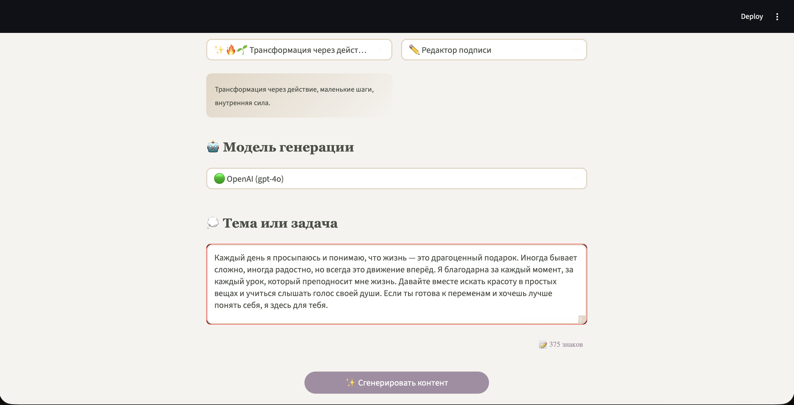

# Генератор контента в голосе бренда «Познай себя»

Веб-приложение пишет тексты для соцсетей и рассылок бренда «Познай себя» в его фирменном тоне. Пользователь выбирает настроение, формат и тему, и через несколько секунд получает готовый текст.


## О проекте

Характер бренда зашит в само приложение: аудитория, уместная лексика, правила обращения к читательнице и то, чего в текстах избегать, плюс пять фирменных настроений. Поэтому тональность не приходится описывать заново в каждом запросе, как в универсальном чат-боте.

Модель выбирается прямо в интерфейсе: GPT-4o для чистовых текстов или бесплатная DeepSeek R1 через OpenRouter для черновиков и экспериментов.

## Задача

Бренд «Познай себя» работает с женщинами 35–45 лет, которые ищут баланс и путь к себе. Ему нужен регулярный контент: посты, сторис, подписи к фото, рассылки. Тексты пишутся урывками и разными людьми, и бренд в каждой публикации звучит по-своему.

Универсальные чат-боты не спасают: каждый раз приходится объяснять тон, аудиторию и формат, а результат все равно выходит безликим и требует правок.

## Решение

1. **Пять настроений бренда.** Естественная гармония, осознанная поддержка, трансформация через действие, глубина и безопасность, аутентичность. У каждого свое описание и слова-маркеры для модели.
2. **Пять форматов.** Пост для Instagram на 150–200 слов, сценарий сторис на 3–5 слайдов, редактор подписи (переписывает готовый текст в стиле бренда), пять идей для публикаций на неделю, письмо для рассылки на 100–150 слов.
3. **Две модели.** GPT-4o через OpenAI или DeepSeek R1 через OpenRouter. Переключаются в выпадающем списке.
4. **Готовый результат.** Текст копируется одной кнопкой или скачивается файлом `.md` для архива и согласования.
5. **Командная строка.** Те же настроения и форматы доступны из терминала, если генерацию нужно встроить в автоматизацию.
6. **Лимиты для публичного демо.** Число генераций ограничено на сессию и на день, чтобы демо не расходовало ключ без меры.

## Как это выглядит

**Настроение, формат и модель** выбираются из выпадающих списков.

| Настроение | Формат | Модель |
|:-:|:-:|:-:|
|  |  |  |

**Редактор подписи.** Сюда вставляется исходный текст, счетчик символов обновляется на ходу.



**Примеры текстов.** В `demo/` лежат тексты всех пяти форматов от обеих моделей. Например, пост на тему «Горы лечат» в настроении естественной гармонии: `content_post_openai_*.md` и `content_post_openrouter_*.md`.

## Результат

- Готовый текст появляется примерно за минуту вместо получаса на черновик.
- Тон и словарь бренда заданы в приложении, их не нужно держать в голове автора.
- 25 сочетаний: пять настроений на пять форматов.
- Черновики можно генерировать бесплатной моделью, платная остается для чистовых текстов.

## Стек технологий

| Технология | Зачем используется |
|---|---|
| **Python** | Язык проекта, в контейнере 3.12 |
| **Streamlit** | Веб-интерфейс с выпадающими списками, кнопками копирования и скачивания |
| **OpenAI API (GPT-4o)** | Основная модель для чистовых текстов |
| **OpenRouter (DeepSeek R1)** | Бесплатная модель для черновиков |
| **Rich** | Читаемый вывод в командной строке |
| **python-dotenv** | API-ключи в `.env`, вне кода |
| **Docker Compose** | Запуск веб-интерфейса на сервере |

## Структура репозитория

- `streamlit_app.py`: веб-интерфейс.
- `vibe_assistant.py`: командная строка.
- `config.py`: настройки бренда, настроения и палитра.
- `prompts.py`: шаблоны промптов для каждого формата.
- `utils.py`: сохранение результатов, меню командной строки и журнал работы.
- `demo/`: скриншоты и примеры текстов.
- `output/examples/`: примеры генерации в JSON.

## Запуск

```bash
pip install -r requirements.txt
cp .env-example.txt .env      # ключи OpenAI и/или OpenRouter
streamlit run streamlit_app.py
```

Достаточно одного ключа из двух. Модели по умолчанию: `gpt-4o` и `deepseek/deepseek-r1-0528:free`.

Из командной строки:

```bash
python vibe_assistant.py --vibe natural_harmony --type post --topic "Утренние ритуалы"
python vibe_assistant.py --vibe transformation --type post --topic "Маленькие шаги" --openrouter
```

Настроения: `natural_harmony`, `mindful_support`, `transformation`, `depth_safety`, `authenticity`. Форматы: `post`, `story`, `caption`, `ideas`, `email`.

В Docker: `docker compose up -d --build`, интерфейс откроется на `http://127.0.0.1:8002`. Лимиты демо задаются переменными `DEMO_MAX_PER_SESSION` (по умолчанию 10) и `DEMO_MAX_PER_DAY` (150).

## Автор

Татьяна Дзюбас, AI-инженер по автоматизации. Делаю Telegram-ботов, RAG-ассистентов и LLM-агентов, которые снимают рутину с небольших команд. Кейсы и контакты на [tatidzufri.com](https://tatidzufri.com).
