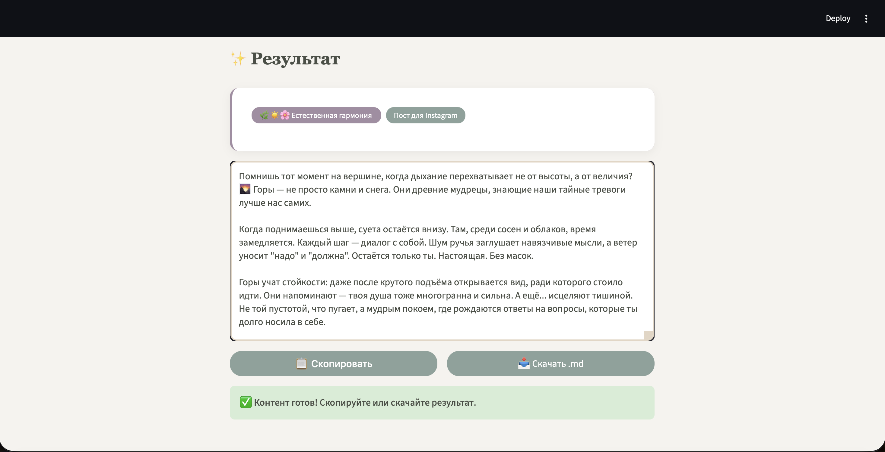
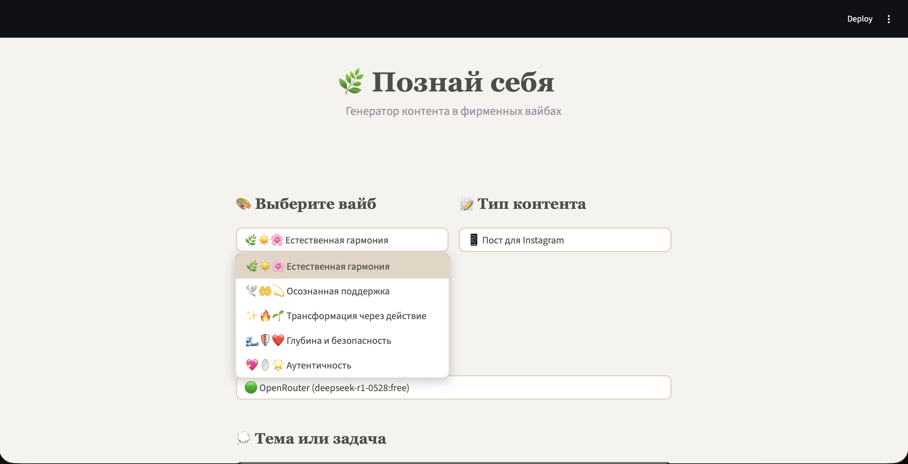
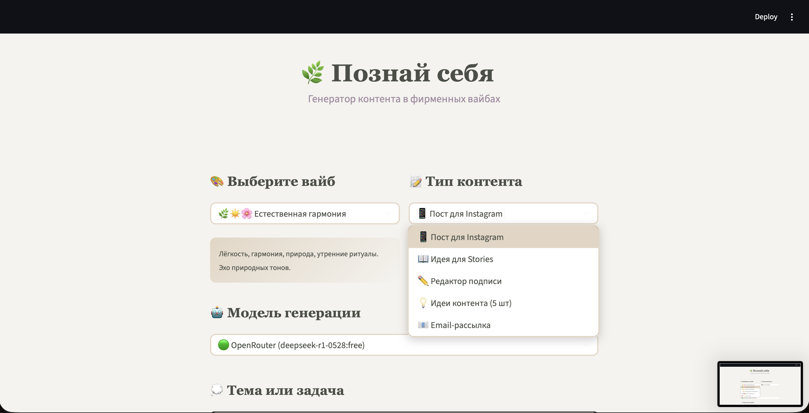
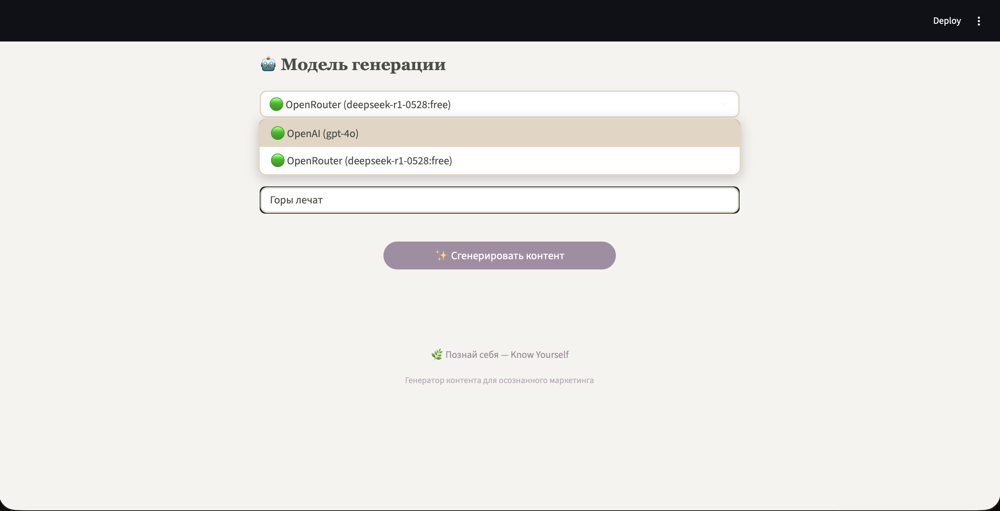

# Brand-voice content generator: five formats, five moods, two models

A web app that writes social media posts and newsletter texts in a brand's signature tone. The user picks a mood, a format and a topic and gets a finished text.

This is a practice project. The brand, "Know Yourself" («Познай себя»), belongs to a training scenario of a retreat center, not a real organization. The interface works in Russian and English. Live demo: [content.tatidzufri.com](https://content.tatidzufri.com). Case study: [tatidzufri.com/en/case/content-generator](https://tatidzufri.com/en/case/content-generator).



## About the project

The brand's character is built into the app: the audience, the right vocabulary, how to address the reader, what to avoid, plus five signature moods. So the tone doesn't have to be described again in every request, as it does with a general-purpose chatbot.

The model is chosen right in the interface: GPT-4o for final texts or the free NVIDIA Nemotron 3 Ultra via OpenRouter for drafts and experiments.

## The task

The brand speaks to women aged 35 to 45 who are looking for balance and a path to themselves. It needs regular content: posts, stories, photo captions, newsletters. When texts are written in bits and by different people, the brand sounds different in every post.

General-purpose chatbots don't solve this: every time you explain the tone, audience and format, and the result still comes out faceless and needs editing.

## How it works

1. **Five brand moods.** Natural harmony, mindful support, transformation through action, depth and safety, authenticity. Each has its own description and marker words for the model.
2. **Five formats.** An Instagram post of 150–200 words, a 3–5 slide stories script, a caption editor (rewrites an existing text in the brand's style), five post ideas for the week, a newsletter of 100–150 words.
3. **Two models.** GPT-4o via OpenAI or a free model via OpenRouter (currently NVIDIA Nemotron 3 Ultra), switched in a dropdown.
4. **A ready result.** The text is copied with one button or downloaded as a `.md` file for the archive and approval.
5. **Command line.** The same moods and formats are available from the terminal, for when generation has to be part of an automation.
6. **Limits for the public demo.** Generations are capped per session and per day, so the demo doesn't drain the key.

## What it looks like

**Mood, format and model** are picked from dropdowns.

| Mood | Format | Model |
|:-:|:-:|:-:|
|  |  |  |

**Caption editor.** The source text goes here; the character counter updates as you type.


**Sample texts.** `demo/` has texts in all five formats from both models. For example, a post on "Mountains heal" in the natural harmony mood: `content_post_openai_*.md` and `content_post_openrouter_*.md`.

## Results

- The brand's tone and vocabulary live in the app, not in the writer's head.
- 25 combinations: five moods times five formats.
- Drafts can be generated with a free model, keeping the paid one for final texts.

## Tech stack

| Technology | What it's for |
|---|---|
| **Python** | Project language, 3.12 in the container |
| **Streamlit** | Web interface with dropdowns, copy and download buttons |
| **OpenAI API (GPT-4o)** | Main model for final texts |
| **OpenRouter (Nemotron 3 Ultra)** | Free model for drafts |
| **Rich** | Readable command-line output |
| **python-dotenv** | API keys in `.env`, outside the code |
| **Docker Compose** | Runs the web interface on the server |

## Repository structure

- `streamlit_app.py`: the web interface.
- `vibe_assistant.py`: the command line.
- `config.py`: brand settings, moods and palette.
- `prompts.py`: prompt templates for each format.
- `utils.py`: saving results, the command-line menu and the work log.
- `demo/`: screenshots and sample texts.
- `output/examples/`: generation examples in JSON.

## Running it

```bash
pip install -r requirements.txt
cp .env-example.txt .env      # OpenAI and/or OpenRouter keys
streamlit run streamlit_app.py
```

One of the two keys is enough. Default models: `gpt-4o` and `nvidia/nemotron-3-ultra-550b-a55b:free`. Free OpenRouter models come and go or turn paid (that's how `deepseek/deepseek-r1-0528:free` disappeared in November 2026): swapping is one `OPENROUTER_MODEL` line in `.env`; the current list is at openrouter.ai/models?variant=free.

From the command line:

```bash
python vibe_assistant.py --vibe natural_harmony --type post --topic "Morning rituals"
python vibe_assistant.py --vibe transformation --type post --topic "Small steps" --openrouter
```

Moods: `natural_harmony`, `mindful_support`, `transformation`, `depth_safety`, `authenticity`. Formats: `post`, `story`, `caption`, `ideas`, `email`.

With Docker: `docker compose up -d --build`; the interface opens on `http://127.0.0.1:8002`. Demo limits are set with `DEMO_MAX_PER_SESSION` (10 by default) and `DEMO_MAX_PER_DAY` (150).

## Author

Tetiana Dziubas, AI automation engineer. I build Telegram bots, RAG assistants and LLM agents that take routine work off small teams. Case studies and contact: [tatidzufri.com/en](https://tatidzufri.com/en/).
