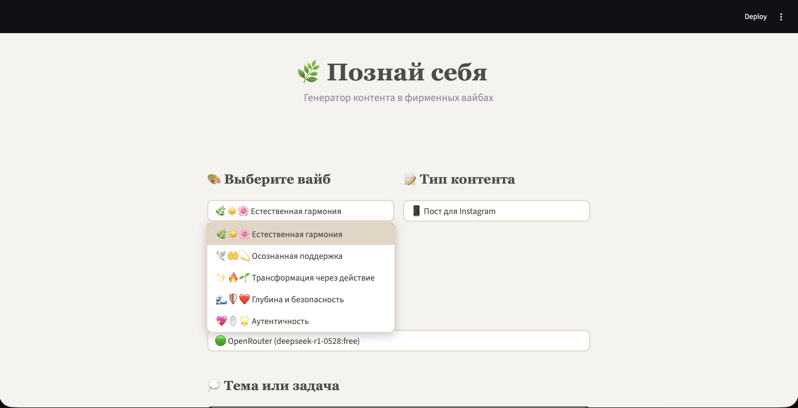
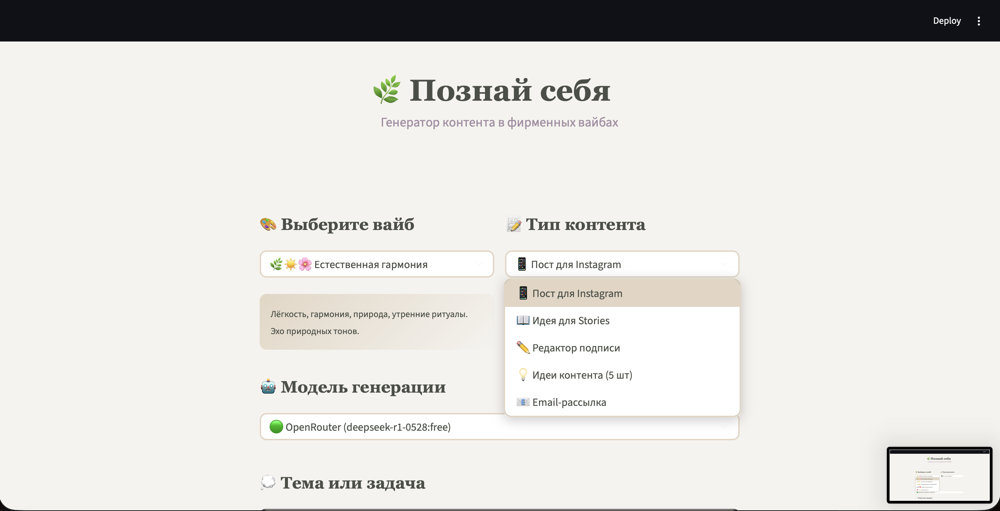
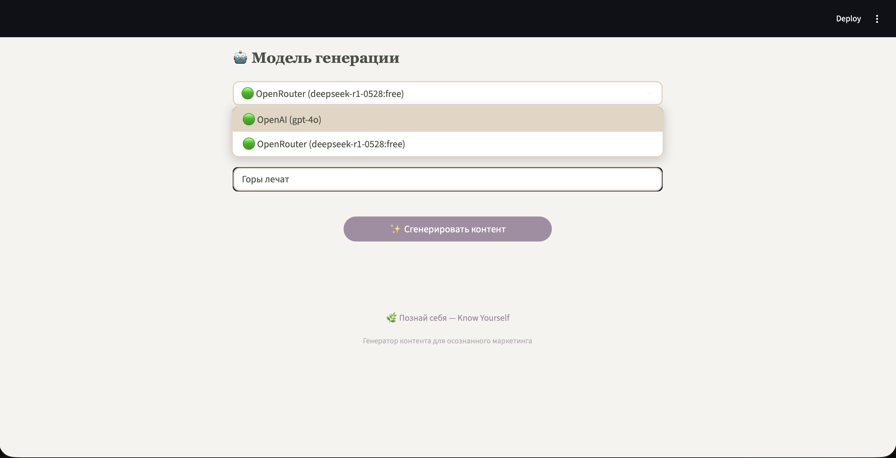
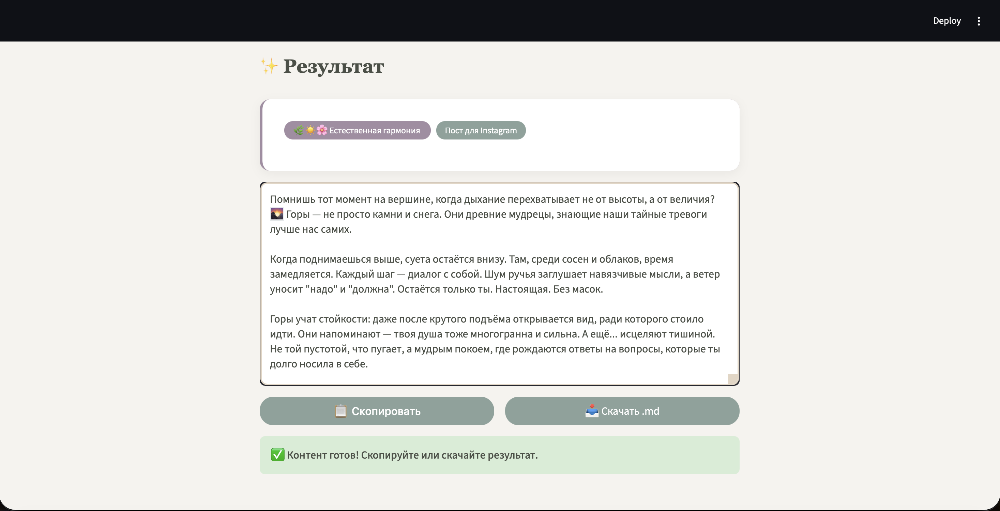
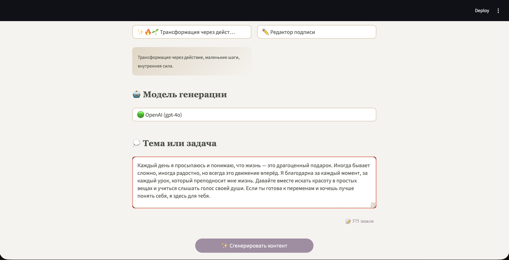

# 🎨 Галерея: ИИ-ассистент «Познай себя»

Демонстрация возможностей генератора контента в фирменных вайбах бренда.

---

## 🖼️ Интерфейс приложения

### Выбор вайба

Пять фирменных настроений бренда:
- 🌿☀️🌸 Естественная гармония
- 🕊️🤲💫 Осознанная поддержка
- ✨🔥🌱 Трансформация через действие
- 🌊🛡️❤️ Глубина и безопасность
- 💖🪞🌟 Аутентичность

---

### Выбор типа контента

Пять форматов генерации:
- 📱 Пост для Instagram
- 📖 Идея для Stories
- ✏️ Редактор подписи
- 💡 Идеи контента (5 шт)
- 📧 Email-рассылка

---

### Выбор модели генерации

Две модели на выбор:
- 🟢 **OpenAI (gpt-4o)** — основная модель
- 🟢 **OpenRouter (deepseek-r1-0528:free)** — бесплатная альтернатива

---

### Результат генерации

**Что получает пользователь:**
- Метки вайба и типа контента
- Готовый текст в текстовом поле
- Кнопки «Скопировать» и «Скачать .md»
- Уведомление о готовности

---

### Редактор подписи

**Особенности режима:**
- Вставка исходного текста для редактирования
- Счётчик символов в реальном времени
- Изменяемая высота поля ввода

---

## 📝 Примеры сгенерированного контента

### Сравнение моделей на одной теме

**Тема:** Горы лечат  
**Вайб:** 🌿 Естественная гармония

| Модель | Файл |
|--------|------|
| OpenAI (gpt-4o) | `content_post_openai_20260120_003519.md` |
| OpenRouter (deepseek-r1) | `content_post_openrouter_20260120_003439.md` |

---

### Все типы контента

| Тип | OpenAI | OpenRouter |
|-----|--------|------------|
| **Пост** | `content_post_openai_*.md` | `content_post_openrouter_*.md` |
| **Stories** | `content_story_openai_*.md` | `content_story_openrouter_*.md` |
| **Подпись** | `content_caption_openai_*.md` | `content_caption_openrouter_*.md` |
| **Идеи** | `content_ideas_openai_*.md` | `content_ideas_openrouter_*.md` |
| **Email** | `content_email_openai_*.md` | `content_email_openrouter_*.md` |

---

## 📁 Содержимое папки

### Скриншоты интерфейса (5 файлов)

| Файл | Описание |
|------|----------|
| `01_dropdown_vibes.png` | Выбор вайба |
| `02_dropdown_content_types.png` | Выбор типа контента |
| `03_dropdown_models.png` | Выбор модели генерации |
| `04_result_post.png` | Результат генерации |
| `05_caption_editor.png` | Редактор подписи со счётчиком |

### Примеры контента (10 файлов)

Каждый тип контента сгенерирован двумя моделями для сравнения:

- `content_post_openai_*.md` / `content_post_openrouter_*.md`
- `content_story_openai_*.md` / `content_story_openrouter_*.md`
- `content_caption_openai_*.md` / `content_caption_openrouter_*.md`
- `content_ideas_openai_*.md` / `content_ideas_openrouter_*.md`
- `content_email_openai_*.md` / `content_email_openrouter_*.md`

---

*🌿 Познай себя — Know Yourself*  
*Генератор контента для осознанного маркетинга*
